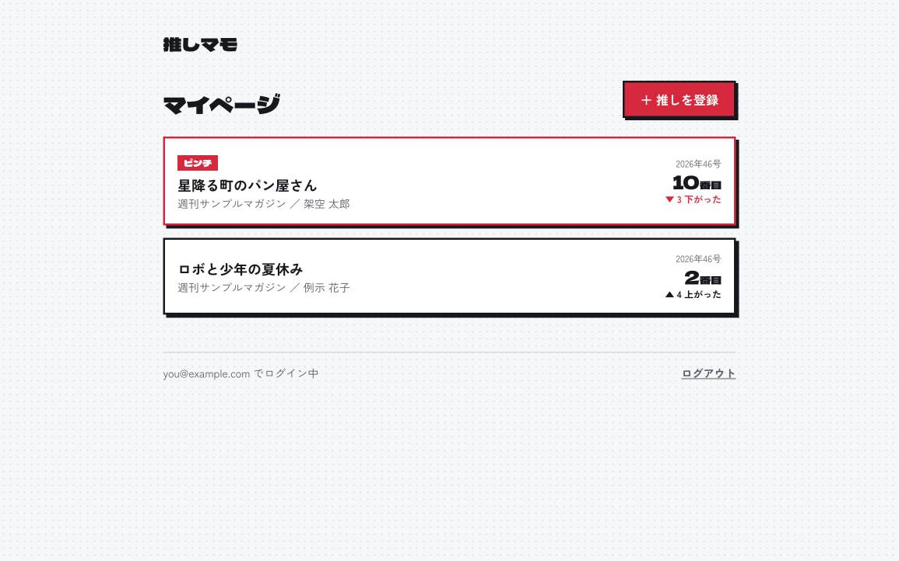
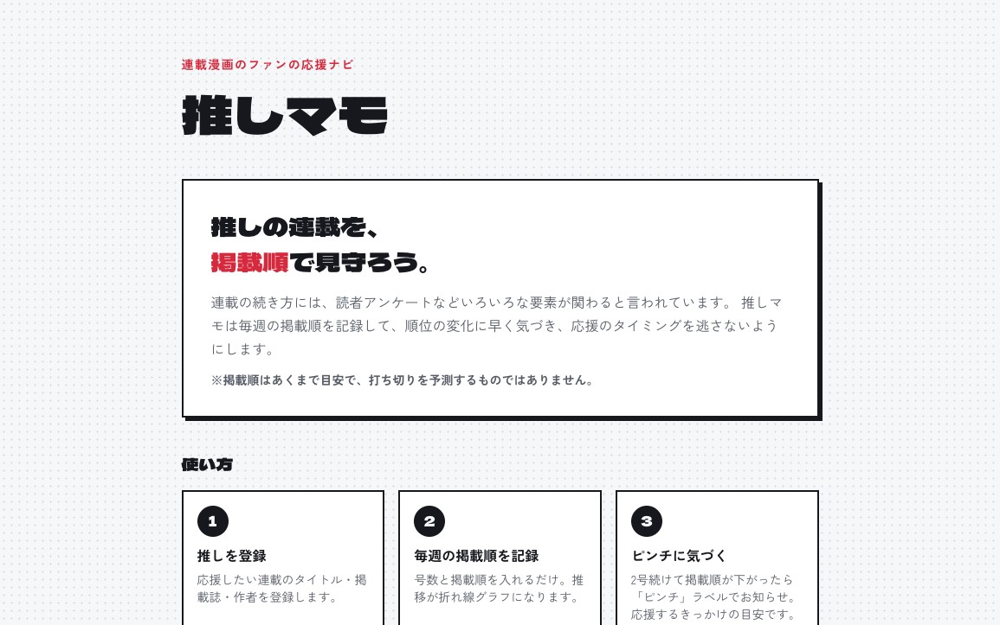
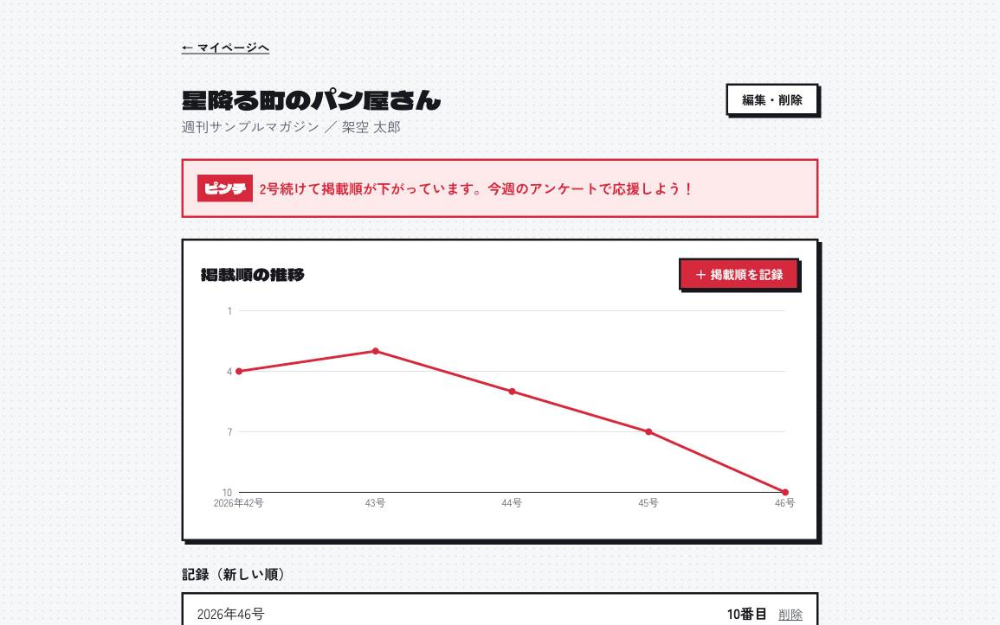
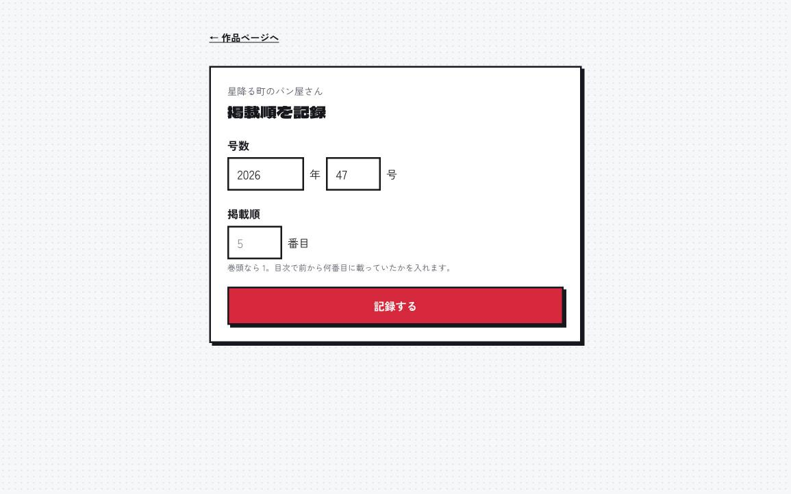
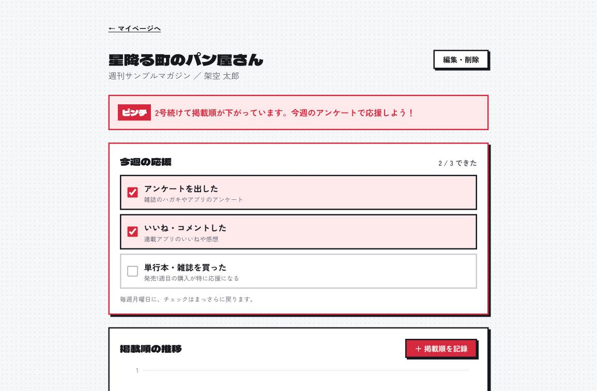
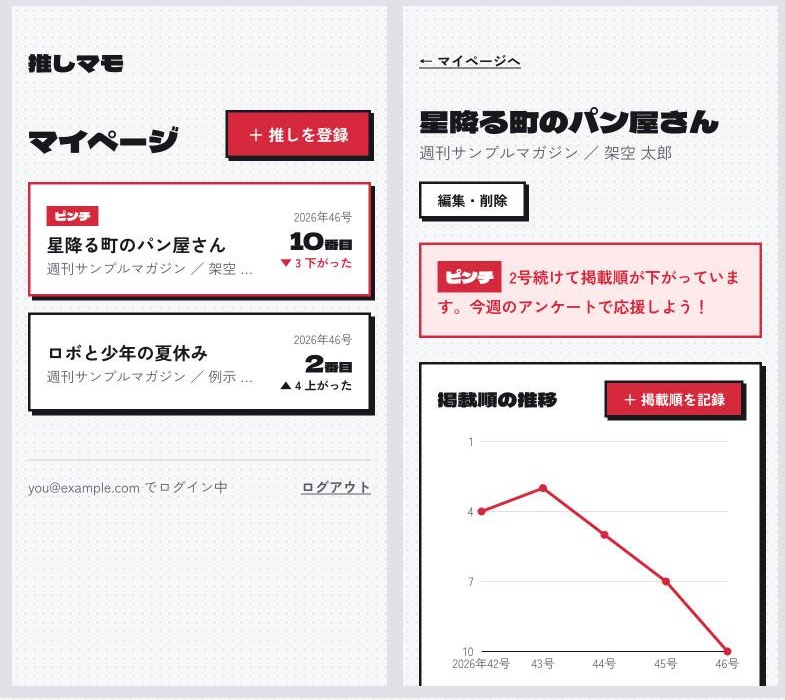

# 推しマモ

**推しの連載を、掲載順で見守ろう。**
連載漫画のファンが、推し作品の「掲載順」を毎週記録して、順位の変化に早く気づくための応援ナビです。

- 公開URL: https://oshimamo.vercel.app
- GitHub: https://github.com/takagaku1117-ai/oshimamo
- 要件定義書: [requirements.md](requirements.md)



## 誰のため？

週刊連載をアプリや雑誌で毎週読んでいて、**好きな作品の掲載順が下がってきて不安なファン**のためのツールです。

連載の続き方には、読者アンケートなどいろいろな要素が関わると言われています。でも、毎週の掲載順は覚えていられないので、順位が下がってきたことに気づくのが遅れがちです。

推しマモは **「掲載順を記録する → 推移をグラフで見る → 2号続けて下がったらピンチを知らせる」** の1つに絞って、応援のタイミングを逃さないようにします。

> 「ピンチ」は、掲載順の変化に気づくための**目安**です。打ち切りを予測するものではありません。

## できること

| 画面                                  | できること                                                                            |
| ------------------------------------- | ------------------------------------------------------------------------------------- |
|         | **トップ**：サービスの説明と Google ログインの入口                                    |
|    | **作品ページ**：掲載順の推移グラフ（上ほど前）。2号続けて下がると赤い「ピンチ」バナー |
|  | **掲載順を記録**：年・号・掲載順の数字3つだけ。次の号が自動で入り、同じ号は上書き     |
|  | **今週の応援**（発展アイデア①）：アンケート・いいね・購入をチェック。ピンチの週に「次に何をするか」まで進める |
|  | **スマホ対応**：幅 375px でも崩れない                                                 |

| ID   | 機能                                                                                             |
| ---- | ------------------------------------------------------------------------------------------------ |
| F-01 | Google ログイン。未ログインで `/me` 以下を開くと `/login` に移動し、ログイン後に元のページへ戻る |
| F-02 | 推し作品の登録・編集・削除（タイトル必須、掲載誌・作者は任意）                                   |
| F-03 | マイページに推しカードを一覧表示。最新の掲載順と前回からの上下（▲▼）                             |
| F-04 | 号数（年・号）と掲載順の記録。同じ号は上書き                                                     |
| F-05 | 掲載順の推移を折れ線グラフで表示                                                                 |
| F-06 | 直近3号で2回続けて下がったら「ピンチ」を表示（例: 5→8→11 はピンチ、5→5→9 や 5→9→7 は対象外）     |
| F-08 | 今週の応援チェックリスト（アンケート・いいね・購入）。押した瞬間にチェックが付き、毎週月曜日（日本時間）にまっさらに戻る。マイページのカードに「今週の応援 2/3」 |

著作権に配慮して、漫画の画像や本文は保存も表示もしません。記録するのはタイトルなどの事実情報と掲載順だけです。

## 技術スタック

| 分類           | 使ったもの                                                                        |
| -------------- | --------------------------------------------------------------------------------- |
| フレームワーク | Next.js 16（App Router・Cache Components・Server Actions）/ React 19 / TypeScript |
| スタイル       | Tailwind CSS v4（配色トークンは `src/app/globals.css` の `@theme`）               |
| 認証・DB       | Supabase（Auth の Google OAuth / Postgres / Row Level Security）、`@supabase/ssr` |
| グラフ         | Recharts                                                                          |
| テスト         | Node.js 標準の `node:test`（ピンチ判定など）                                      |
| 公開           | Vercel（GitHub に push すると自動デプロイ）                                       |

### データ設計とセキュリティ

| テーブル   | 主な列                                  | 誰が読み書きできるか           |
| ---------- | --------------------------------------- | ------------------------------ |
| `works`    | title, magazine, author, user_id        | 登録した本人だけ               |
| `rankings` | work_id, issue_year, issue_no, position | 自分の作品にぶら下がる記録だけ |
| `cheers` | work_id, kind, week_start | 自分の作品にぶら下がるチェックだけ |

- 全テーブルで RLS（Row Level Security）を有効にしています。別のユーザーからは見えない・書き込めないことを SQL でなりすましてテストしました
- 号数は「2026年47号」という文字列ではなく、年と号の数値2列で持っています（文字列だと「5号」が「47号」より後ろに並んでしまうため）
- ログイン後の戻り先はサイト内のパスだけ許可して、外部サイトに飛ばされないようにしています

テーブル定義は [`supabase/migrations/`](supabase/migrations/) にあります。

## ローカルで動かす

```bash
npm install
cp .env.example .env.local   # Supabase の URL と公開キーを入れる
npm run dev                  # http://localhost:3000
```

- Supabase のプロジェクトで `supabase/migrations/` の SQL を実行して、テーブルと RLS を作ります
- Google ログインを使うには、Google Cloud で OAuth クライアントを作り、Supabase の Authentication → Providers → Google に設定します

```bash
npm test        # ピンチ判定などのテスト
npm run lint
npm run build
```

## Claude Code で作りました

| 使った機能            | どう使ったか                                                                                                       |
| --------------------- | ------------------------------------------------------------------------------------------------------------------ |
| Plan Mode             | 6つの実装ステップすべてで、計画 → 承認 → 実装の順に進めた。いきなり実装させない                                    |
| CLAUDE.md と `@` 参照 | `@requirements.md` と `@AGENTS.md` を読み込ませ、「要件にない機能は足さない」「1ステップずつ」などのルールを書いた |
| `/init`               | 既存の CLAUDE.md を残したまま、コマンドとコードの構成を追記させた                                                  |
| カスタムスキル        | 自作の `/new-migration` で、RLS とコメント付きのマイグレーションを作った                                           |
| Supabase MCP          | プロジェクト作成・テーブル適用・RLS のテスト・型の生成をチャットから行った                                         |
| Claude in Chrome      | 登録 → 記録 → ピンチ → 削除の流れや、スマホ幅の表示を実際のブラウザで確認した                                      |
| Git ワークフロー      | 1ステップごとに動作確認してから、機能要件のID入りの日本語メッセージでコミットした                                  |
