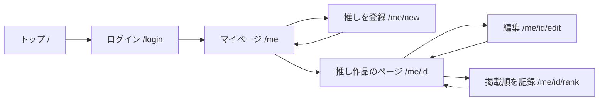

# 要件定義書：推しマモ

好きな連載漫画の掲載順を見守り、応援のタイミングを逃さないためのファンの応援ナビ

- 作成日: 2026-10-26
- 版: 1.1（2026-10-28 MVP を「掲載順でピンチに気づく」コア機能 F-01〜F-06 に絞り込み）
- 関連資料: `design/story_map.html`（ユーザーストーリーマップ） / `design/sitemap.html`（サイトマップ・ページ一覧表）

---

## 1. プロジェクト概要

### 背景

- 雑誌やアプリの連載漫画は、読者アンケートの順位、単行本の発売1週目の売れ行き、電子版の閲覧数やいいねなどをもとに、連載を続けるかどうかが判断されると言われている。
- 好きな作品が打ち切りになってから「もっと応援しておけばよかった」と気づくファンは多い。
- ファン1人ができる応援（アンケートを出す、発売週に買う、友達に勧める）は、締切や発売日を忘れると効果が薄れる。何が応援として効くのかも分かりにくい。

### 目的

- MVP: ファンが **推し作品の掲載順の推移を記録し、打ち切りのピンチに早く気づける** 状態をつくる（1機能特化）。
- v1.0 以降: ファンが「いつ・何をすれば応援になるか」を忘れずに実行でき、まだ読んでいない人にも作品を勧めやすい状態をつくる。

### スコープ

|              | 含むもの（MVP）                                  | 含まないもの                                                                            |
| ------------ | ------------------------------------------------ | --------------------------------------------------------------------------------------- |
| 推し管理     | 推し作品の登録・編集・削除・一覧、Googleログイン | 書誌APIでの自動登録（v1.0）                                                             |
| ピンチの把握 | 掲載順の手入力、推移グラフ、ピンチ表示           | 掲載順の自動取得、他のファンとの集計（v2.0）                                            |
| 応援         | —                                                | 発売1週目の強調・応援チェックリスト・応援ログ（v1.0）、LINE通知・応援カレンダー（v1.0） |
| 布教         | —                                                | 紹介ページ・「読んだよ」ボタン（v1.0）、紹介カード画像（v1.0）、AI紹介文（v2.0）        |
| その他       | —                                                | お問い合わせ（v1.0）、漫画の画像・本文の掲載（著作権のため扱わない）、決済・投げ銭      |

---

## 2. ユーザーストーリー

### ペルソナ

| ID  | ペルソナ                          | 状況                                                           | 困りごと                                                         |
| --- | --------------------------------- | -------------------------------------------------------------- | ---------------------------------------------------------------- |
| P-1 | 応援するファン サキ（29・会社員） | 週刊連載をアプリで毎週読む。好きな新連載の掲載順が下がってきた | アンケート締切や発売日を忘れる。何が応援として効くのか分からない |
| P-2 | 紹介される読者 ユウ（22・大学生） | 漫画はアプリの無料分だけ読む。友達からLINEで紹介が届いた       | どこまで読めばハマるか、いつどこで買えばいいか分からない         |

### ストーリー（MVP）

```
US-01
As a 応援するファン,
I want 推し作品をタイトル・掲載誌・作者で登録できること,
So that 応援したい作品をまとめて管理できる.

US-02
As a 応援するファン,
I want 毎週の掲載順を記録して推移をグラフで見られること,
So that 作品がピンチになっていることに早く気づける.
```

### ストーリー（v1.0）

```
US-03
As a 応援するファン,
I want 単行本の発売日を登録して、発売1週目が強調表示されること,
So that 継続の判断材料になる初動の時期に買い逃さない.

US-04
As a 応援するファン,
I want 作品ごとに今週の応援（アンケート・いいね・購入）をチェックできること,
So that やるべき応援を漏れなく済ませられる.

US-05
As a 応援するファン,
I want 推しポイントを書いた紹介ページを作ってURLで共有できること,
So that 友達に作品を勧めて読者を増やせる.

US-06
As a 応援するファン,
I want これまでの応援回数と記録を見られること,
So that 続けてきた応援を振り返ってモチベーションを保てる.

US-07
As a 紹介される読者,
I want ログインせずに紹介ページを開いて、公式の試し読みや書店に移動できること,
So that 手間をかけずに自分に合う作品か確かめられる.

US-08
As a 紹介される読者,
I want 「読んだよ」ボタンで紹介者に読んだことを伝えられること,
So that 勧めてくれた人に反応を返せる.

US-09
As a 応援するファン,
I want アンケート締切と発売日の前日・当日にLINEで通知が届くこと,
So that 忙しい日でも応援を忘れない.

US-10
As a 紹介される読者,
I want 発売1週目に買うことがなぜ応援になるのかを読めること,
So that 同じお金を使うなら一番効果のあるタイミングで買える.
```

---

## 3. 機能要件

| ID   | 機能名             | 説明                                                                                                                 | 優先度 | Phase |
| ---- | ------------------ | -------------------------------------------------------------------------------------------------------------------- | ------ | ----- |
| F-01 | Googleログイン     | Supabase Auth の Google OAuth でログイン。未ログインで `/me` 以下にアクセスしたら `/login` に移動                    | 高     | MVP   |
| F-02 | 推し作品の登録     | タイトル（必須）・掲載誌・作者を入力して登録。編集・削除もできる                                                     | 高     | MVP   |
| F-03 | 推し一覧           | マイページに推し作品をカードで表示。各カードに最新の掲載順と前回からの上下を出す                                     | 高     | MVP   |
| F-04 | 掲載順の記録       | 号数（例: 2026年47号 → 年と号を数値で保存）と掲載順（数値）を入力。同じ号は上書き                                    | 高     | MVP   |
| F-05 | 掲載順グラフ       | 作品ごとに掲載順の推移を折れ線で表示（上ほど掲載順が前）                                                             | 中     | MVP   |
| F-06 | ピンチ表示         | 直近3号で掲載順が2回続けて下がったら（例 5→8→11）、推し一覧のカードと作品ページに「ピンチ」を出す。横ばい・一度でも上がった場合は出さない。打ち切りの予測ではなく、掲載順の変化に気づくための目安として表示する | 中     | MVP   |
| F-07 | 発売1週目の強調    | 発売日から7日間、推し一覧と応援ページに「発売1週目」を表示                                                           | 高     | v1.0   |
| F-08 | 応援チェックリスト | 作品ごとに週単位（月曜始まり）で「アンケートを出した」「いいねした」「購入した」をチェック。翌週は未チェックに戻る   | 高     | 発展①（実装済み）   |
| F-09 | 応援ログ           | チェックした応援を日付つきで保存し、合計回数と作品ごとの一覧を表示                                                   | 中     | v1.0   |
| F-10 | 紹介ページ作成     | 推しポイント（最大400字）・ジャンル・公式試し読みURL・書店URLを入力して公開URL `/r/[slug]` を発行。URLをコピーできる | 高     | v1.0   |
| F-11 | 紹介ページ表示     | ログインなしで閲覧可能。推しポイントと外部リンクを表示し、漫画の画像は載せない                                       | 高     | v1.0   |
| F-12 | 「読んだよ」ボタン | 紹介ページで押すとカウントが1増え、紹介者のマイページに件数が表示される。同じブラウザからの連打は1回として扱う       | 中     | v1.0   |
| F-13 | お問い合わせ       | 名前・メール・内容を送信し、Supabase のテーブルに保存                                                                | 低     | v1.0   |
| F-14 | 作品検索・登録     | 書誌API（楽天ブックスAPIなど）で作品を検索し、表紙・巻数つきで登録                                                   | 中     | v1.0  |
| F-15 | 応援カレンダー     | アンケート締切と単行本発売日を月表示                                                                                 | 中     | v1.0  |
| F-16 | LINEリマインド     | LINE Messaging API で前日と当日に通知。通知設定ページで連携・オンオフ                                                | 中     | v1.0  |
| F-17 | 応援のやり方ガイド | アンケート・発売1週目の購入・電子版のいいねが応援になる理由を解説する静的ページ                                      | 低     | v1.0  |
| F-18 | 紹介カード画像     | SNSに貼れる紹介画像（OGP）を生成                                                                                     | 低     | v1.0  |
| F-19 | AI紹介文           | 相手の好きな作品を入力すると、Claude API が相手向けの紹介文を作る                                                    | 低     | v2.0  |
| F-20 | 掲載順の集計       | 複数ファンの記録を合わせて作品ごとの掲載順を表示                                                                     | 低     | v2.0  |

---

## 4. 非機能要件

- **パフォーマンス**: どのページも初回読み込み 3 秒以内（スマホの4G回線を想定）。
- **セキュリティ**:
  - 認証は Google OAuth（Supabase Auth）。メールアドレスとパスワードの登録は MVP では作らない。
  - 全テーブルで Row Level Security を有効にし、推し作品・掲載順は本人だけが読み書きできる。
  - APIキーなどの秘密情報は Vercel の環境変数に置き、リポジトリに含めない。
- **可用性**: SLA 99%（Vercel と Supabase の無料枠に従う）。Supabase 無料枠は1週間アクセスがないと一時停止するため、運用中は週1回以上アクセスがある前提とする。
- **スケーラビリティ**: 同時接続 100 ユーザー。登録ユーザー 1,000 人、推し作品 5,000 件までを無料枠で扱える想定。
- **対応端末**: スマホ（幅 375px 以上）を最優先。PC でも崩れないこと。
- **使いやすさ**: 掲載順の記録は、マイページを開いてから 3 タップ以内で 1 作品分を終えられる。
- **著作権への配慮**: 漫画の画像・本文・ネタバレ画像はアップロードも表示もしない。作品情報はタイトル・作者・掲載誌などの事実情報に限る。

---

## 5. 制約条件

- **予算**: 無料枠で完結（Vercel Hobby / Supabase Free）。
- **期間**: 約 1 週間（MVP のみ）。
  - 前半: 土台・DB・認証
  - 後半: 推し登録・一覧・掲載順の記録とグラフ・ピンチ表示・公開
- **技術**: Next.js（App Router・TypeScript）+ Supabase（Auth・Postgres）+ Vercel。スタイルは Tailwind CSS。グラフは Recharts。
- **体制**: 1 人開発（Claude Code を使って実装）。

---

## 6. 画面遷移

### サイトマップ

```
トップページ                          /                MVP
├── 推し作品を探す                     /works           v1.0
│   └── 作品詳細                       /works/[id]      v1.0
├── マイページ（推し一覧）             /me              MVP
│   ├── 推しを登録                     /me/new          MVP
│   ├── 推し作品のページ               /me/[id]         MVP
│   │   ├── 編集                       /me/[id]/edit    MVP
│   │   ├── 掲載順を記録               /me/[id]/rank    MVP
│   │   └── 紹介ページを作る           /me/[id]/share   v1.0
│   ├── 応援カレンダー                 /me/calendar     v1.0
│   ├── 応援ログ                       /me/log          v1.0
│   └── 通知設定（LINE連携）           /me/settings     v1.0
├── 紹介ページ（公開）                 /r/[slug]        v1.0
├── 応援のやり方ガイド                 /guide           v1.0
├── ログイン                           /login           MVP
└── お問い合わせ                       /contact         v1.0
```

### 主な画面遷移（MVP）



### ページ一覧（MVP）

| ページ名         | URL             | 目的                               | 主要機能                                     | 関連する機能要件 |
| ---------------- | --------------- | ---------------------------------- | -------------------------------------------- | ---------------- |
| トップ           | `/`             | サービスの説明と入口               | 仕組みの説明 / ログインボタン                | —                |
| ログイン         | `/login`        | 推しの記録をアカウントに保存       | Googleでログイン                             | F-01             |
| マイページ       | `/me`           | 推しとピンチの作品を一目で見る     | 推しカード / 最新の掲載順 / ピンチラベル     | F-03, F-06       |
| 推しを登録       | `/me/new`       | 作品を追加                         | 作品情報の入力                               | F-02             |
| 推し作品のページ | `/me/[id]`      | 1作品の掲載順の推移を見る          | 掲載順グラフ / 記録の一覧 / 編集・削除       | F-02, F-05, F-06 |
| 編集             | `/me/[id]/edit` | 作品情報を直す                     | 作品情報の修正                               | F-02             |
| 掲載順を記録     | `/me/[id]/rank` | 毎週の掲載順を残す                 | 号数と掲載順の入力・修正                     | F-04             |

v1.0 のページ（応援ログ・紹介ページ・お問い合わせなど）は版 1.0 の内容を引き継ぐ（`design/sitemap.html`）。

### データ設計（MVP）

| テーブル   | 主な列                                              | 備考                                    |
| ---------- | --------------------------------------------------- | --------------------------------------- |
| `works`    | id, user_id, title, magazine, author, created_at    | 推し作品。本人のみ読み書き              |
| `rankings` | id, work_id, issue_year, issue_no, position, recorded_at | 掲載順。`(work_id, issue_year, issue_no)` で一意。号を数値で持つのは並び順を正しくするため。本人の作品のものだけ読み書き |

発展① で追加: `cheers`（id, work_id, kind, week_start, checked_at。`(work_id, kind, week_start)` で一意。週は日本時間の月曜始まり。本人の作品のものだけ読み書き）。

v1.0 で追加予定: `works.next_release_date`、`shares`（紹介ページ）、`contacts`（お問い合わせ）。

---

## 7. 参考デザイン

- 画面のトーンは `design/story_map.html` に合わせる（白い紙にスクリーントーンの点、黒い太枠のコマ、MVP の赤をアクセントカラーにする）。
- マイページの推しカードは、読書記録アプリの本棚のように作品が縦に並ぶ一覧を参考にする。

---

## Claude Code への指示例

```
requirements.md を読んで、Phase が MVP の機能要件（F-01〜F-06）を実装して。
CLAUDE.md の実装ステップの順に、1 ステップずつ Plan Mode で計画してから進めて、
1 つ終わるごとに動作確認の方法を教えて。
```
